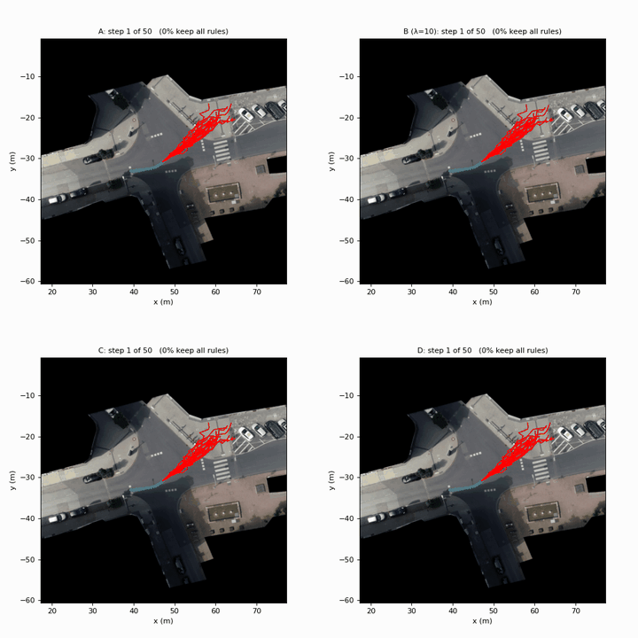
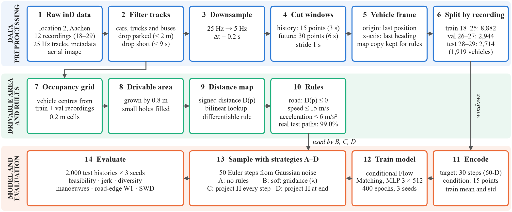
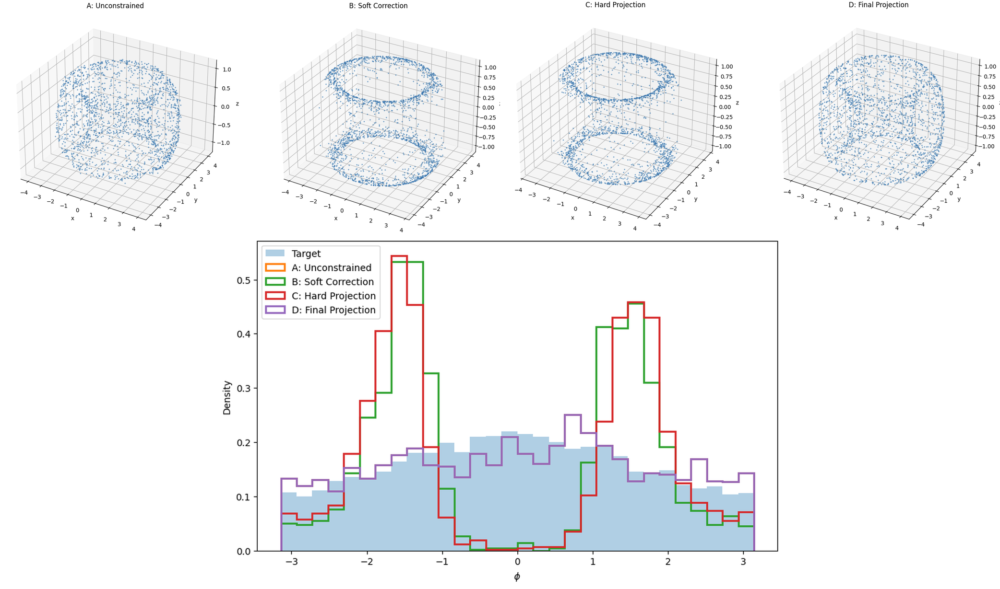
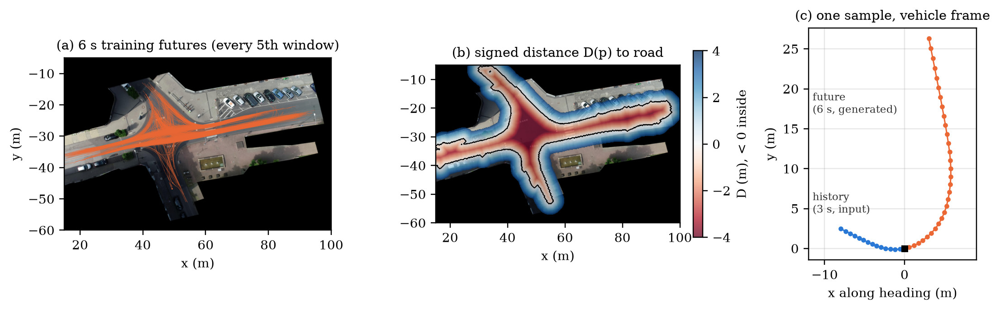
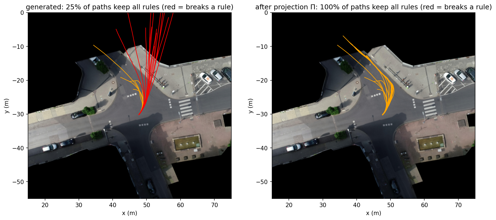
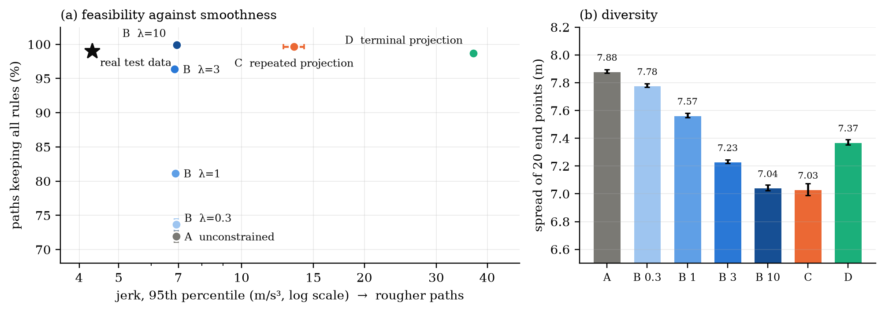
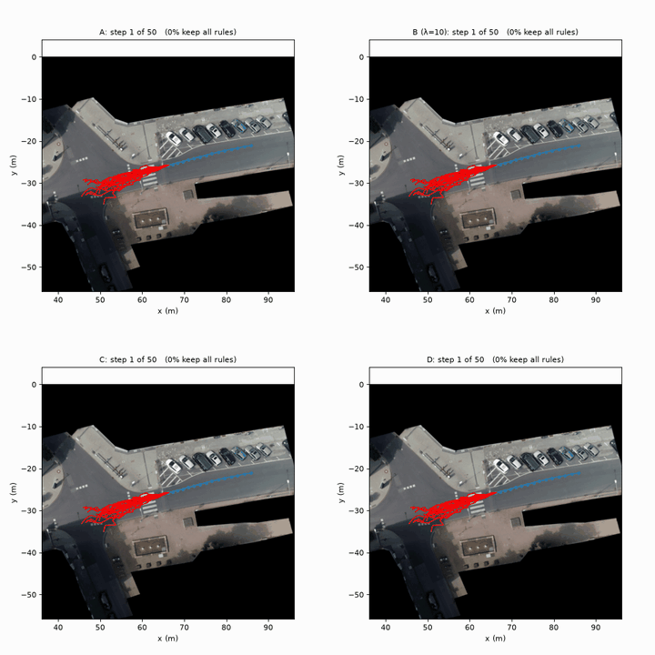
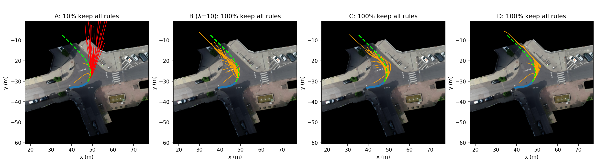
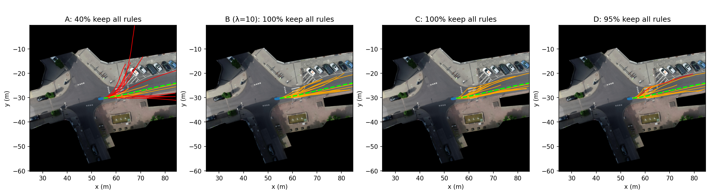
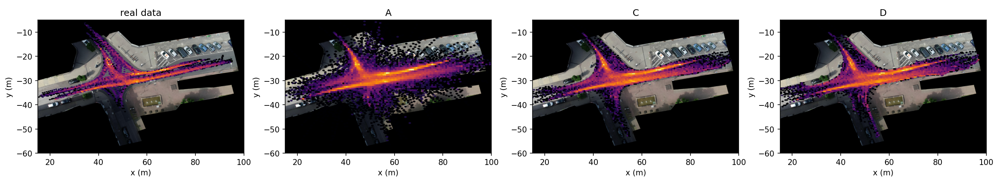

# When Should Constraints Enter Flow Matching? From a Torus to Vehicle Trajectories at an Urban Intersection

When during sampling, and how strongly, should physical rules enter a generative model? We compare four strategies on a toy torus and on real drone recordings of an intersection in Aachen, Germany.


-1baf7a)


<p align="center">
  
</p>
<p align="center"><sub>
Twenty possible futures for one left-turning car, generated from noise in 50 steps by the <b>same trained model</b> with four strategies.
<b>Red</b> paths break a rule, <b>orange</b> paths keep all rules, the <b>blue</b> dots are the 3-second history and the <b>green dashed</b> line is what the driver actually did.
A: no rules · B: soft guidance · C: hard projection at every step · D: one projection at the end.
</sub></p>

---

## Highlights

- **A generative trajectory model.** A conditional Flow Matching model draws the next 6 s of a vehicle's path from its last 3 s, using 14,540 history–future windows cut from 4 hours of inD drone recordings.
- **Without rules, 28% of the futures leave the road.** The model has learned realistic motion (speed and acceleration limits are practically never broken), but it has never seen the map.
- **Soft guidance with λ = 10, repeated projection and terminal projection all reach the feasibility of real driving** (98.7–99.9% of paths keep all rules, against 99.0% for the real test data), **but only soft guidance does it for free**: repeated hard projection doubles the 95th-percentile jerk, a single projection at the end multiplies it by five.
- **The toy problem points the wrong way.** On a torus, projecting once at the end is the best strategy and per-step correction is the worst. The reason is the type of constraint: the torus is an equality (every point must lie *on* a surface), the road rules are inequalities (a path only has to stay *inside* a region).

## Contents

[The problem](#the-problem) · [Method](#method) · [Experiment 1: torus](#experiment-1-torus) · [Experiment 2: vehicle trajectories](#experiment-2-vehicle-trajectories) · [What we learned](#what-we-learned) · [Repository](#repository) · [Reproduce](#reproduce) · [Documents and team](#documents-and-team)

---

## The problem

Motion planners and traffic simulators need a *set* of plausible futures for every road user, not a single guess: at an intersection, the same approach can end in a left turn, a straight crossing or a stop. Generative models produce such sets, but nothing in their sampling guarantees that a sample is physically possible. A generated path can cut across a pavement or demand an acceleration no car can deliver, and for a planner such a path is not unlikely but invalid.

Rules can be built into the model, steered in with gradients, or enforced by projection. We ask the practical question that remains: **given one trained model, when during sampling, and how strongly, should the rules be enforced?**

## Method

<p align="center"></p>
<p align="center"><sub>The complete pipeline: raw inD recordings → cleaned history–future windows → drivable area and rules → conditional Flow Matching model → sampling with strategies A–D → evaluation.</sub></p>

**Flow Matching.** The model learns a velocity field $v_\theta(x, t, c)$ that moves Gaussian noise $x_0$ along straight lines to data $x_1$, conditioned on the history $c$:

$$x_t = (1-t)\,x_0 + t\,x_1, \qquad \mathcal{L}(\theta) = \mathbb{E}\,\big\lVert v_\theta(x_t, t, c) - (x_1 - x_0)\big\rVert^2 .$$

Samples are drawn by integrating $v_\theta$ from noise ($t = 0$) to data ($t = 1$) with Euler steps (50 for trajectories, 100 on the torus). Because the path is a straight line, every intermediate state also gives the model's current estimate of the *finished* sample, $\hat x_1 = x_t + (1-t)\,v_\theta$. For trajectories, strategies B and C check the rules on this estimate, because the noisy state itself is not yet a path; on the torus they act on the state directly.

**Four strategies, one model.** All strategies share the same trained network and sampler and differ only in what happens around each step, so every difference in the results comes from the strategy:

| | Strategy | When the rules enter | On the torus | On trajectories |
|---|---|---|---|---|
| **A** | Unconstrained | never | plain sampling | plain sampling |
| **B** | Soft correction | every step, partially | damped Newton step towards the surface (λ = 0.3) | velocity pushed by −λ∇P(x̂₁), λ ∈ {0.3, 1, 3, 10} |
| **C** | Repeated hard projection | every step, fully | exact projection onto the surface | x̂₁ projected with Π, state rebuilt on the straight line |
| **D** | Terminal projection | once, at the end | exact projection of the final sample | Π applied to the final path |

## Experiment 1: torus

A torus with radii R = 3 and r = 1 and a surface-uniform target (20,000 training points) gives a constraint that is known exactly: $h(x, y, z) = (\sqrt{x^2+y^2} - R)^2 + z^2 - r^2 = 0$. An MLP (4 × 256, SiLU) is trained once; each strategy then generates 2,000 samples, repeated over 10 seeds.

<p align="center"></p>

| Method | Feasibility: mean \|h\| ↓ | Fidelity: sliced Wasserstein ↓ | Intrinsic fidelity: φ-W1 ↓ |
|---|---|---|---|
| A · unconstrained | 9.4·10⁻² ± 2.0·10⁻³ | 0.087 ± 0.012 | 0.116 |
| B · soft correction | 3.8·10⁻² ± 3.7·10⁻⁴ | 0.125 ± 0.011 | 0.424 |
| C · repeated hard projection | 1.0·10⁻⁷ ± 2.2·10⁻⁹ | 0.146 ± 0.009 | 0.454 |
| **D · terminal projection** | **1.5·10⁻⁷ ± 2.2·10⁻⁹** | **0.083 ± 0.014** | **0.116** |

**Terminal projection is free on the torus.** It moves each sample onto the surface along the line through the tube centre, so the angles that describe *where* on the torus the sample lies are unchanged. Correcting at every step instead pushes the samples into two rings at the top and bottom of the tube (φ ≈ ±π/2), even though C places every point exactly on the surface. The lesson we carried over: feasibility and fidelity must be measured separately.

## Experiment 2: vehicle trajectories

### Data: why inD, and what we did with it

We use the [inD dataset](https://levelxdata.com/ind-dataset/) (Bock et al., 2020) from levelXdata: 33 drone recordings (9.8 h, 13,599 road users) of four intersections in Aachen, with every road user tracked at 25 Hz in metric coordinates, plus an aerial image and a road map per site.

- **Why a drone dataset:** the view from above has no occlusions and gives positions in metres, so the rules can be checked directly on the map and every result can be drawn on the real scene.
- **Why an intersection:** the same approach can end in different manoeuvres (left, straight, right, stop), which is exactly the multimodality a generative model is for.
- **Why location 2 (Frankenburg):** it has the most recordings (12) and the longest recording time (4.0 h) of the four sites, enough to hold out whole recordings for testing. Location 1 has a similar number of vehicles but a second road layout during a construction phase.

| Step | Choice | Why |
|---|---|---|
| Road users | cars and trucks/buses (2,436) | the road, speed and acceleration rules apply to motor vehicles |
| Sampling rate | 25 Hz → 5 Hz | 30 points per 6 s; acceleration noise from tracking is 25× smaller than at 25 Hz |
| Parked cars | removed (231) | they would add 242,135 motionless windows, about 17× all moving ones |
| Window | 3 s history + 6 s future, 1 s stride | long enough for turns to show, short enough to keep 87% of the moving vehicles |
| Coordinates | vehicle frame (origin at the car, x-axis along its heading) | the model learns motion, not positions |
| Split | by recording: 18–25 / 26–27 / 28–29 | overlapping windows of one car never leak into the test set |

The result: **14,540 windows from 1,919 vehicles** (8,882 train, 2,944 validation, 2,714 test). One sample is 30 future displacements (60 numbers) conditioned on 15 history positions (30 numbers).

<p align="center"></p>

### Rules

| Rule | Meaning | Check (g ≤ 0) |
|---|---|---|
| Road | the vehicle centre stays on the drivable area | D(pₖ) ≤ 0, with D the signed distance to the area |
| Speed | at most 15 m/s, just above the 13.9 m/s (50 km/h) limit | ‖pₖ − pₖ₋₁‖ / Δt − 15 ≤ 0 |
| Acceleration | at most 6 m/s², including lateral acceleration in turns | ‖pₖ₊₁ − 2pₖ + pₖ₋₁‖ / Δt² − 6 ≤ 0 |

The drivable area is built from where vehicle centres were observed in the training and validation data (0.2 m grid, grown by 0.8 m), because the rule constrains the vehicle's centre, which never reaches the kerb. Real test driving passes the rules: **100% stay on the road, 100% below the speed bound, 99.0% satisfy all three** (the remaining 1% are acceleration spikes from tracking noise).

**Projection Π** finds the closest path that keeps all rules by gradient descent on a penalty with safety margins, followed by a pass that clips speed and acceleration. Repairing the rules *jointly* matters: a first version that repaired them one at a time raised feasibility only from 84% to 86%, because snapping points onto the road created corners that broke the acceleration rule; the joint version reached 99%.

<p align="center"></p>

### Results

Mean ± standard deviation over three trained models, 2,000 test histories each:

| Strategy | Feasible paths ↑ | Road violation (m) ↓ | Jerk p95 (m/s³) | Diversity (m) ↑ | Road-edge W1 (m) ↓ | Left / right turns (%) |
|---|---|---|---|---|---|---|
| A · unconstrained | 71.9 ± 0.8% | 0.223 | 6.93 | 7.88 | 0.483 | 10.1 / 5.4 |
| B · λ = 0.3 | 73.7 ± 0.8% | 0.181 | 6.92 | 7.78 | 0.432 | 10.1 / 5.3 |
| B · λ = 1 | 81.1 ± 0.4% | 0.105 | 6.89 | 7.57 | 0.338 | 9.7 / 5.2 |
| B · λ = 3 | 96.4 ± 0.3% | 0.019 | 6.86 | 7.23 | 0.229 | 9.3 / 4.7 |
| **B · λ = 10** | **99.9 ± 0.05%** | **0.000** | 6.93 | 7.04 | 0.211 | 8.6 / 4.3 |
| C · repeated projection | 99.7 ± 0.1% | 0.001 | 13.44 | 7.03 | **0.173** | 8.7 / 4.1 |
| D · terminal projection | 98.7 ± 0.3% | 0.001 | 36.98 | 7.37 | 0.211 | 8.8 / 4.9 |
| *Real test data* | *99.0%* | *0* | *4.30* | – | *0* | *12.0 / 8.8* |

<p align="center"></p>

- **Feasibility is solved by all three corrections.** B with λ = 10, C and D all reach the level of real driving.
- **Smoothness separates them.** B corrects a little at every step and lets the model's own velocity field absorb each correction, so it adds no roughness. C repairs fully at every step and doubles the jerk. D lets the model finish an infeasible path and then bends it back onto the road in one go, which leaves visible kinks: five times the jerk.
- **The strict corrections cost some variety.** Diversity drops by 6–11% for B (λ = 10), C and D, mostly through fewer turns, because turning paths are the ones that leave the road and get corrected.

<p align="center">
  
</p>
<p align="center"><sub>
A second car, driving straight on. The model imagines two manoeuvres, going straight and turning left into the side street. Without rules (A), 20% of the paths leave the road, among them turning paths that cut the corner across the pavement. Every correction keeps both manoeuvres, but on the road.
</sub></p>

<p align="center"></p>
<p align="center"></p>
<p align="center"><sub>Final paths per strategy for a left-turning car (top) and a car driving straight on (bottom). D's kinks are visible where the projection bends paths back onto the road.</sub></p>

<p align="center"></p>
<p align="center"><sub>Where 2,000 test futures go. Unconstrained futures leak onto pavements and the parking lot; constrained futures follow the real lanes.</sub></p>

## What we learned

- **A feasibility score alone ranks the methods wrongly.** On the torus, C has the lowest constraint violation and the worst fidelity; on the road, B, C and D are equally feasible but differ by a factor of five in jerk.
- **Equality and inequality constraints behave differently.** An equality moves every sample at every step, so repeated correction accumulates and distorts the distribution. An inequality acts mainly on the paths that would break it, so repeated correction on the road costs about 11% of the diversity rather than the whole distribution.
- **A projection that is free for a point is not free for a path.** On the torus, the projection keeps a sample's intrinsic coordinates; on the road, it changes the shape of a path, and the change shows up as a kink.
- **Practical recipe (still to be tested):** guide gently throughout sampling and, where a guarantee is needed, project once at the end, when little is left to repair.

**Limitations.** One intersection, three trained models, one architecture per experiment; the model does not see the map; the rules are physical, not legal, so *feasible* does not mean *safe*. Best-of-K displacement errors and a yaw-rate check were not computed.

## Repository

```
vehicle-trajectory-generation/
├── README.md
├── BUILD_PLAN.md                    plan of the project and the order of the steps
├── guide/                           step-by-step guides, steps 1–11
├── offline/                         laptop notebooks: raw inD → windows → drivable area
│   ├── 01_explore_data.ipynb
│   ├── 02_Make the samples.ipynb      → data_processed/train, val, test.npz
│   └── 03_road_and_rules.ipynb        → data_processed/road_grid.npz
├── colab/
│   ├── DM2583_project.ipynb         model, rules, strategies A–D, metrics, experiment, demo
│   └── torus_flow_matching.ipynb    Experiment 1: the torus
├── models/                          trained trajectory models (seeds 0, 1, 2)
├── results/                         metrics per strategy and seed (+ torus, 10 seeds)
├── figures/                         figures from the offline steps
├── docs/                            animations and report figures
└── data/, data_processed/           local only, never committed (inD licence)
```

## Reproduce

```bash
git clone https://github.com/fammad/vehicle-trajectory-generation.git
cd vehicle-trajectory-generation
python3.11 -m venv .venv
source .venv/bin/activate            # Windows: .venv\Scripts\activate
pip install -r requirements.txt
```

1. **Get the data.** inD is free for non-commercial research after a request at [levelxdata.com](https://levelxdata.com/ind-dataset/). Copy the files of recordings 18–29 from the dataset's `data/` folder into `data/`. The data is not redistributed here.
2. **Build the windows and the road grid** (laptop, a few minutes): run `offline/01`, `02` and `03` in order. They write `train.npz`, `val.npz`, `test.npz` and `road_grid.npz` to `data_processed/`.
3. **Run the experiment** in `colab/DM2583_project.ipynb`. The notebook reads from `MyDrive/Group 5 - Big Data/DM2583_project/` on Google Drive (change `PROJECT` in the first cell): put `data_processed/` there, `18_background.png` and `18_recordingMeta.csv` in `raw/`, and the files from `models/` in `outputs/` to skip training (otherwise about 5 minutes per seed on a GPU). The notebook ends with an interactive demo: pick a car and a λ with sliders and see the four strategies side by side.
4. **The torus** in `colab/torus_flow_matching.ipynb` needs no data and runs on a CPU.

`results/results_v2.csv` holds every metric for each strategy and seed, `results/results_table_v2.csv` the mean ± standard deviation, and `results/torus_10_seeds.csv` the torus metrics per seed.

## Documents and team

- **Process:** the [project proposal](G5%20-%20PROJECT%20PROPOSAL%202026.md), the [build plan](BUILD_PLAN.md) and the [step guides](guide/).

**Group 5**, DM2583 Big Data in Media Technology, KTH Royal Institute of Technology, October 2026:
Fuad Mammadov · Gala Flores García · Harshit Poddar

**Data.** inD dataset by ika, RWTH Aachen University, distributed by [levelXdata](https://levelxdata.com/). Used under its licence for non-commercial research; the recordings are not stored in this repository.

```bibtex
@inproceedings{inDdataset,
  title     = {The inD Dataset: A Drone Dataset of Naturalistic Road User Trajectories at German Intersections},
  author    = {Bock, Julian and Krajewski, Robert and Moers, Tobias and Runde, Steffen and Vater, Lennart and Eckstein, Lutz},
  booktitle = {2020 IEEE Intelligent Vehicles Symposium (IV)},
  pages     = {1929--1934},
  year      = {2020}
}
```
